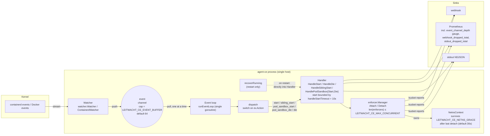

# Event flow

How a container start lands on the eBPF + DNS proxy + nftables stack,
and where each tunable along the way bites.

## Big picture



`recoverRunning` runs once at agent startup against containers that
were already alive when the agent attached. It calls Handler methods
directly (no event-channel hop). Operators sizing `MAX_CONCURRENT` for
restart storms need to know the burst hits Handler before the
event-loop goroutine is even reading from the channel.

## Lifecycle of one CI job

1. **kubelet** starts the runner pod's pause container, then the build
   container.
2. **containerd** emits `TaskStart` events to all NRI / event
   subscribers. The agent's `ContainerdWatcher` receives them on a
   long-lived gRPC subscription.
3. The watcher converts the runtime-specific event into a plain
   `watcher.ContainerEvent` (the agent's lingua franca) and writes it
   to its **buffered event channel**. The same channel powers
   `Handler.Watcher.Watch(ctx)`.
4. **`runEventLoop`** is a single goroutine that consumes the channel
   in order:

   ```go
   for {
       select {
       case ev := <-events:
           dispatch(ctx, h, ev)   // synchronous
       case <-ctx.Done():
           ...
       }
   }
   ```

   Synchronous dispatch is intentional. It keeps event ordering exact
   (`pod_sandbox_start` → `start` → `die` cannot reorder) and avoids
   per-job goroutine fan-out, which would otherwise race against the
   eBPF cgroup attach window.
5. `dispatch` routes by `ev.Action` to one of the `Handler.Handle*`
   methods. The hot path is `HandleStart`:
   - Bound the call by `handleStartTimeout` (10s).
   - `Policy.GetPolicy` (CE: direct YAML lookup; EE: BBolt-cached
     gRPC). On miss the handler fails open with `DefaultAction`.
   - Run the security gauntlet (DinD, socket mount, FF_NETWORK_PER_BUILD,
     credwatch/proc_mem flags) — kill or warn per `pol.Action`.
   - `Enforcer.Attach` builds (or reuses) a `NetnsContext`, loads the
     eBPF programs, attaches nftables, starts the per-netns DNS proxy.
6. `dispatch` returns; the loop reads the next event.
7. On `die`, `Enforcer.Detach` decrements the netns context's refcount.
   When the last container leaves, the context is **deferred-torn-down
   after `LEITWACHT_CE_NETNS_GRACE`** (default 30s) — this is what lets
   K8s init-containers exit before the build container without the
   netns infrastructure dying first.

## The event channel: why it exists, what it gates

The channel between the watcher and the event loop is the single
back-pressure surface in the agent.

**Producer (watcher):** non-blocking write would drop events; a
blocking write back-pressures the containerd / Docker event-stream
goroutine, which queues events inside the runtime client's gRPC
buffer. The agent never drops events at this seam — under sustained
overload, the runtime client is what eventually surfaces the
back-pressure (channel depth pegged at cap is the leading signal).
We use a **blocking send** with a buffered channel.

**Consumer (event loop):** synchronous handler. While `HandleStart` is
running for one container, no other events are processed. Worst-case
budget per event: `handleStartTimeout = 10s`. Realistic: tens of ms
because policy lookups are local (CE) or cache hits (EE).

**Sizing:** the only documented number is `DefaultEventBuffer = 64`
in `agentcore/watcher/watcher.go`. The recommendations below are
**rules of thumb, not benchmarked** — start at the default, watch
the depth gauge under your real CI load, raise if it pegs.

| Scenario                                  | Rule of thumb |
| ----------------------------------------- | ------------- |
| Default — sized for the legitimate peak of a single node | 64 |
| Heavy CI burst (≫ 100 jobs simultaneously) | 256–512 |
| Diagnostic — find a leak             | 1024 + watch the gauge |

**Metric:** `leitwacht_ce_event_channel_depth` (gauge, sampled on
scrape via a Prometheus `GaugeFunc` over `Watcher.ChannelDepth()`).

| Reading | What it means | Action |
| --- | --- | --- |
| 0  | Handler keeps up. | None. |
| 1–10 occasionally | Normal burstiness. | None. |
| Rising and not falling | Handler stuck on a slow event, or burst exceeds buffer. | Investigate handler-side: stuck `Attach`, gRPC backend, slow webhook. |
| Pegged at `LEITWACHT_CE_EVENT_BUFFER` | The watcher is back-pressuring containerd. | Raise the buffer; tune `LEITWACHT_CE_MAX_CONCURRENT`; profile the handler. |

## `LEITWACHT_CE_MAX_CONCURRENT`

Caps `len(m.enforcers)` — which holds **alive enforcers plus the nil
sentinel slots reserved during in-flight Attach calls**. Because
dispatch is single-threaded, only one Attach is ever in flight, so in
practice this is "alive enforcers + at most one." The cap exists so a
long-tail of leaked netns contexts can't exhaust file descriptors,
BPF map slots, or DNS proxy sockets.

Hit at `Attach`:

```go
if len(m.enforcers) >= m.maxConc {
    return ErrMaxConcurrent
}
```

When you bump it, also raise `nofile` and `BPF_MAP_*` limits if your
host is conservative about either.

## `LEITWACHT_CE_NETNS_GRACE`

The grace period the netns context survives after its last container
exits. K8s init-container patterns rely on this: the init container
exits, the build container starts a fraction of a second later, both
share a netns — without grace, the second container would arrive after
the eBPF/DNS infrastructure had already been torn down.

Failure mode logged at WARN:

```
netns context torn down after grace period — any sibling that joins
now will lose audit-mode rules from this netns
```

Pair this warning with "missed enforcement" or "init-container exited
before build attached" reports to confirm the grace is too short.

A `deferredTeardown` goroutine sleeps `LEITWACHT_CE_NETNS_GRACE` for
each netns whose last container detaches. Under churn there can be N
of these sleepers concurrently. Raising the grace to minutes amplifies
this — typically fine, but worth knowing if you're tuning at high
throughput.

## Other observability counters

- `leitwacht_ce_webhook_dropped_total` — webhook reports dropped
  (encode failure, queue overflow, or in-flight cancellation).
  Registered only when a webhook URL is configured **and** Prom is
  enabled. Persistently rising = SIEM forwarder breaking; investigate.
- `leitwacht_ce_stdout_dropped_total` — NDJSON records dropped because
  the async stdout queue overflowed (slow writer — typically a network
  mount or slow log shipper).

## Shutdown semantics (`DetachAll`)

On `SIGTERM`, the agent calls `DetachAll`, which detaches every alive
container and then waits up to one `LEITWACHT_CE_BUCKET_INTERVAL`
(default 5 min) for in-flight bucket-flush `ReportFunc` callbacks to
finish. If your pod's `terminationGracePeriodSeconds` is shorter than
`BUCKET_INTERVAL` plus your slowest webhook RTT, kubelet will SIGKILL
mid-flush and the final bucket is lost. Either lower
`BUCKET_INTERVAL` or raise the pod's grace period.

## Tuning matrix

| Knob                          | Default | Symptom telling you to raise              | Symptom telling you to lower |
| ----------------------------- | ------- | ----------------------------------------- | ---------------------------- |
| `LEITWACHT_CE_EVENT_BUFFER`   | 64      | `event_channel_depth` pegged              | Memory pressure on tiny nodes |
| `LEITWACHT_CE_MAX_CONCURRENT` | 64      | `ErrMaxConcurrent` in logs                | OOMKilled at scale (rare)    |
| `LEITWACHT_CE_NETNS_GRACE`    | 30s     | "torn down after grace period" warnings   | nctx leaks; many `deferredTeardown` sleepers under churn |
| `LEITWACHT_CE_BUCKET_INTERVAL`| 5m      | Want fresher data in reports              | `DetachAll` shutdown wait too long for kubelet grace period |
| `LEITWACHT_CE_DNS_UPSTREAM`   | (required) | n/a — no default, must be set explicitly | n/a |
| `handleStartTimeout`          | 10s (constant) | Slow upstreams routinely time out  | n/a — bound exists to bound pause |

## Why dispatch isn't fan-out

Three reasons we keep `runEventLoop → dispatch → HandleStart`
synchronous:

1. **Ordering** — sandbox-then-container-then-die is invariant the
   eBPF cgroup-derivation logic depends on. A worker pool would
   require explicit per-pod serialisation.
2. **Pause-window honesty** — `handleStartTimeout` bounds *the* pause
   window. If 100 container starts arrive at once, processing them
   serially gives the operator a sharp signal (queue depth) instead of
   100 simultaneously-paused containers.
3. **Resource-exhaustion is observable** — the channel depth gauge
   *is* the load signal. Replace dispatch with a worker pool and the
   load signal becomes "average attach latency under contention",
   which is far harder to alert on.

If you ever need to break this: the right move is to fan out per
`PodUID` (so ordering within a pod is preserved), and the right
metric to add first is per-pod queue depth. The synchronous design
is the v0.x default because it's easier to reason about, not because
fan-out is forbidden.

## Two-layer enforcement: DNS + IP default-deny

The agent enforces at both layers — DNS proxy decides allow/block by
domain, and the eBPF egress program is **default-deny on IPs**. The
allow map is populated when the DNS proxy answers an allowed query
with that domain's resolved IPs; everything else (loopback, trusted
CIDRs, cloud metadata, and policy-explicit deny IPs aside) drops.

### Rule ordering across both layers

`cidr` rules never reach the DNS proxy — there is no name to match on
— so they are installed into the eBPF maps at attach instead. To keep
one rule model across names and addresses, every IP-map entry carries
the **index of the rule that produced it** in the job's composed list,
and the datapath picks the lowest. That reproduces first-match-wins:
a `cidr` allow above a `cidr` deny wins, and a `fqdn` allow above a
`cidr` deny wins too, because the allow-map entries the resolution
seeds inherit that fqdn rule's index.

Two things sit outside the ordering by design:

- **Hard blocks** — cloud metadata (`169.254.169.254`), DoT
  (port 853), and the loopback / link-local carve-outs. These are
  invariants, not policy; no rule ordering can reach them.
- **Trusted CIDRs** (`TRUSTED_CIDRS`, the Docker bridge / pod
  network) hold no position in any rule list, so they are consulted
  only after every rule has missed. An explicit deny rule still
  overrides node-level trust.

`cidr` allow rules must name a single host (a bare IPv4 address or
`/32`) — the allow map is an exact-match hash. Wider prefixes are
rejected when the CE YAML rules are loaded or hot-reloaded (a failed
reload keeps the previous rule set active), rather than silently
installing nothing. The same load-time check rejects IPv6 addresses,
ports outside 0..65535 (1..65535 for allow-listed domains), IP literals
or URLs/ports in domain patterns, invalid hostname characters or labels,
and wildcards other than a whole `*` label (block rules: first label only). The
enforcer re-checks these defensively and skips (with a warning) any
such rule that reaches it from another policy source.

The two layers cooperate against the realistic attack shapes:

- **DNS-then-connect to a blocked domain.** Proxy returns the
  sinkhole IP (`192.0.2.1`); the container's resolver caches that;
  the subsequent TCP SYN hits the sinkhole entry in the deny map and
  is dropped. Two violations attributed to the same domain — one
  `dns_blocked` (with `query_type`), one `sinkhole_hit`.

- **Hardcoded IP, skip DNS.** No DNS query, so the allow map never
  learns the IP. The egress filter's default-deny catches the SYN.
  One violation: `packet_dropped` (no `query_type` since no DNS
  event was involved). Domain field empty unless reverse-cache
  reconciliation finds a prior resolution. A destination that
  legitimately has no name — a deploy target, a ClusterIP — is
  permitted by a `cidr` allow rule, which the operator writes by hand
  or by approving the resulting anomaly. It is never learned
  automatically: a bare address gives a baseline review nothing to
  judge, unlike a domain.

This means a domain-only rule set still catches IP-bypass attempts
without any extra `deny_ips` configuration. See
`agentcore/enforcer/integration_test.go::TestIntegrationBareIPBlocked`
for the regression covering this case end-to-end.
