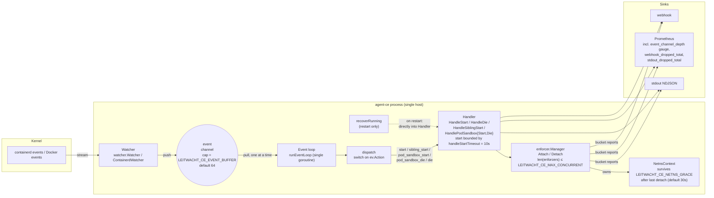

# Event flow

How a container start lands on the eBPF + DNS proxy + nftables stack,
and where each tunable along the way bites.

## Big picture



`recoverRunning` runs once at agent startup against containers that
were already alive when the agent attached. It calls Handler methods
directly (no event-channel hop). Operators sizing `MAX_CONCURRENT` for
restart storms need to know the burst hits Handler before the
event-loop goroutine is even reading from the channel.

## Lifecycle of one CI job

1. **kubelet** starts the runner pod's pause container, then the build
   container.
2. **containerd** emits `TaskStart` events to all NRI / event
   subscribers. The agent's `ContainerdWatcher` receives them on a
   long-lived gRPC subscription.
3. The watcher converts the runtime-specific event into a plain
   `watcher.ContainerEvent` (the agent's lingua franca) and writes it
   to its **buffered event channel**. The same channel powers
   `Handler.Watcher.Watch(ctx)`.
4. **`runEventLoop`** is a single goroutine that consumes the channel
   in order:

   ```go
   for {
       select {
       case ev := <-events:
           dispatch(ctx, h, ev)   // synchronous
       case <-ctx.Done():
           ...
       }
   }
   ```

   Synchronous dispatch is intentional. It keeps event ordering exact
   (`pod_sandbox_start` → `start` → `die` cannot reorder) and avoids
   per-job goroutine fan-out, which would otherwise race against the
   eBPF cgroup attach window.
5. `dispatch` routes by `ev.Action` to one of the `Handler.Handle*`
   methods. The hot path is `HandleStart`:
   - Bound the call by `handleStartTimeout` (10s).
   - `Policy.GetPolicy` (CE: direct YAML lookup; EE: BBolt-cached
     gRPC). On miss the handler fails open with `DefaultAction`.
   - Run the security gauntlet (DinD, socket mount, FF_NETWORK_PER_BUILD,
     credwatch/proc_mem flags) — kill or warn per `pol.Action`.
   - `Enforcer.Attach` builds (or reuses) a `NetnsContext`, loads the
     eBPF programs, attaches nftables, starts the per-netns DNS proxy.
6. `dispatch` returns; the loop reads the next event.
7. On `die`, `Enforcer.Detach` decrements the netns context's refcount.
   When the last container leaves, the context is **deferred-torn-down
   after `LEITWACHT_CE_NETNS_GRACE`** (default 30s) — this is what lets
   K8s init-containers exit before the build container without the
   netns infrastructure dying first.

## The event channel: why it exists, what it gates

The channel between the watcher and the event loop is the single
back-pressure surface in the agent.

**Producer (watcher):** non-blocking write would drop events; a
blocking write back-pressures the containerd / Docker event-stream
goroutine, which queues events inside the runtime client's gRPC
buffer. The agent never drops events at this seam — under sustained
overload, the runtime client is what eventually surfaces the
back-pressure (channel depth pegged at cap is the leading signal).
We use a **blocking send** with a buffered channel.

**Consumer (event loop):** synchronous handler. While `HandleStart` is
running for one container, no other events are processed. Worst-case
budget per event: `handleStartTimeout = 10s`. Realistic: tens of ms
because policy lookups are local (CE) or cache hits (EE).

**Sizing:** the only documented number is `DefaultEventBuffer = 64`
in `agentcore/watcher/watcher.go`. The recommendations below are
**rules of thumb, not benchmarked** — start at the default, watch
the depth gauge under your real CI load, raise if it pegs.

| Scenario                                  | Rule of thumb |
| ----------------------------------------- | ------------- |
| Default — sized for the legitimate peak of a single node | 64 |
| Heavy CI burst (≫ 100 jobs simultaneously) | 256–512 |
| Diagnostic — find a leak             | 1024 + watch the gauge |

**Metric:** `leitwacht_ce_event_channel_depth` (gauge, sampled on
scrape via a Prometheus `GaugeFunc` over `Watcher.ChannelDepth()`).

| Reading | What it means | Action |
| --- | --- | --- |
| 0  | Handler keeps up. | None. |
| 1–10 occasionally | Normal burstiness. | None. |
| Rising and not falling | Handler stuck on a slow event, or burst exceeds buffer. | Investigate handler-side: stuck `Attach`, gRPC backend, slow webhook. |
| Pegged at `LEITWACHT_CE_EVENT_BUFFER` | The watcher is back-pressuring containerd. | Raise the buffer; tune `LEITWACHT_CE_MAX_CONCURRENT`; profile the handler. |

## `LEITWACHT_CE_MAX_CONCURRENT`

Caps `len(m.enforcers)` — which holds **alive enforcers plus the nil
sentinel slots reserved during in-flight Attach calls**. Because
dispatch is single-threaded, only one Attach is ever in flight, so in
practice this is "alive enforcers + at most one." The cap exists so a
long-tail of leaked netns contexts can't exhaust file descriptors,
BPF map slots, or DNS proxy sockets.

Hit at `Attach`:

```go
if len(m.enforcers) >= m.maxConc {
    return ErrMaxConcurrent
}
```

When you bump it, also raise `nofile` and `BPF_MAP_*` limits if your
host is conservative about either.

## `LEITWACHT_CE_NETNS_GRACE`

The grace period the netns context survives after its last container
exits. K8s init-container patterns rely on this: the init container
exits, the build container starts a fraction of a second later, both
share a netns — without grace, the second container would arrive after
the eBPF/DNS infrastructure had already been torn down.

Failure mode logged at WARN:

```
netns context torn down after grace period — any sibling that joins
now will lose audit-mode rules from this netns
```

Pair this warning with "missed enforcement" or "init-container exited
before build attached" reports to confirm the grace is too short.

A `deferredTeardown` goroutine sleeps `LEITWACHT_CE_NETNS_GRACE` for
each netns whose last container detaches. Under churn there can be N
of these sleepers concurrently. Raising the grace to minutes amplifies
this — typically fine, but worth knowing if you're tuning at high
throughput.

## Other observability counters

- `leitwacht_ce_webhook_dropped_total` — webhook reports dropped
  (encode failure, queue overflow, or in-flight cancellation).
  Registered only when a webhook URL is configured **and** Prom is
  enabled. Persistently rising = SIEM forwarder breaking; investigate.
- `leitwacht_ce_stdout_dropped_total` — NDJSON records dropped because
  the async stdout queue overflowed (slow writer — typically a network
  mount or slow log shipper).

## Shutdown semantics (`DetachAll`)

On `SIGTERM`, the agent calls `DetachAll`, which detaches every alive
container and then waits up to one `LEITWACHT_CE_BUCKET_INTERVAL`
(default 5 min) for in-flight bucket-flush `ReportFunc` callbacks to
finish. If your pod's `terminationGracePeriodSeconds` is shorter than
`BUCKET_INTERVAL` plus your slowest webhook RTT, kubelet will SIGKILL
mid-flush and the final bucket is lost. Either lower
`BUCKET_INTERVAL` or raise the pod's grace period.

## Tuning matrix

| Knob                          | Default | Symptom telling you to raise              | Symptom telling you to lower |
| ----------------------------- | ------- | ----------------------------------------- | ---------------------------- |
| `LEITWACHT_CE_EVENT_BUFFER`   | 64      | `event_channel_depth` pegged              | Memory pressure on tiny nodes |
| `LEITWACHT_CE_MAX_CONCURRENT` | 64      | `ErrMaxConcurrent` in logs                | OOMKilled at scale (rare)    |
| `LEITWACHT_CE_NETNS_GRACE`    | 30s     | "torn down after grace period" warnings   | nctx leaks; many `deferredTeardown` sleepers under churn |
| `LEITWACHT_CE_FREEZE_TIMEOUT` | 5s      | "pre-attach freeze failed" in logs         | `0` disables the freeze (job runs unfiltered until attach completes) |
| `LEITWACHT_CE_FREEZE_STATE_DIR` | /run/leitwacht/frozen | n/a | Must survive an agent restart; used to thaw containers a crashed agent left frozen |
| `LEITWACHT_CE_BUCKET_INTERVAL`| 5m      | Want fresher data in reports              | `DetachAll` shutdown wait too long for kubelet grace period |
| `LEITWACHT_CE_DNS_UPSTREAM`   | (required) | n/a — no default, must be set explicitly | n/a |
| `handleStartTimeout`          | 10s (constant) | Slow upstreams routinely time out  | n/a — bounds policy lookup + attach; the freeze has its own hard limit |

## Why dispatch isn't fan-out

Three reasons we keep `runEventLoop → dispatch → HandleStart`
synchronous:

1. **Ordering** — sandbox-then-container-then-die is invariant the
   eBPF cgroup-derivation logic depends on. A worker pool would
   require explicit per-pod serialisation.
2. **Freeze-window honesty** — a container is frozen from the moment
   its start event is *handled* until attach completes, bounded by a
   hard limit. If 100 container starts arrive at once, processing them
   serially gives the operator a sharp signal (queue depth) instead of
   100 simultaneously-frozen containers. Note the flip side: an event
   waiting in the channel is not frozen yet, so a deep queue is also a
   wider unfiltered window — alert on `event_channel_depth`.
3. **Resource-exhaustion is observable** — the channel depth gauge
   *is* the load signal. Replace dispatch with a worker pool and the
   load signal becomes "average attach latency under contention",
   which is far harder to alert on.

If you ever need to break this: the right move is to fan out per
`PodUID` (so ordering within a pod is preserved), and the right
metric to add first is per-pod queue depth. The synchronous design
is the v0.x default because it's easier to reason about, not because
fan-out is forbidden.

## Two-layer enforcement: DNS + IP default-deny

The agent enforces at both layers — DNS proxy decides allow/block by
domain, and the eBPF egress program is **default-deny on IPs**. The
allow map is populated when the DNS proxy answers an allowed query
with that domain's resolved IPs; everything else (loopback, trusted
CIDRs, cloud metadata, and policy-explicit deny IPs aside) drops.

### Rule ordering across both layers

`cidr` rules never reach the DNS proxy — there is no name to match on
— so they are installed into the eBPF maps at attach instead. To keep
one rule model across names and addresses, every IP-map entry carries
the **index of the rule that produced it** in the job's composed list,
and the datapath picks the lowest. That reproduces first-match-wins:
a `cidr` allow above a `cidr` deny wins, and a `fqdn` allow above a
`cidr` deny wins too, because the allow-map entries the resolution
seeds inherit that fqdn rule's index.

Two things sit outside the ordering by design:

- **Hard blocks** — cloud metadata and workload-credential
  endpoints (`169.254.169.254`, the ECS task-role endpoint
  `169.254.170.2`, the EKS Pod Identity endpoint `169.254.170.23` and
  Alibaba's `100.100.100.200` and Tencent's `169.254.0.23`), DoT (port 853), and the loopback /
  link-local carve-outs. These are invariants, not policy; no rule
  ordering can reach them. IPv6 metadata addresses (for example
  `fd00:ec2::254`) need no entry of their own: in block mode all
  non-loopback IPv6 is dropped.
- **Trusted CIDRs** (`TRUSTED_CIDRS`, the Docker bridge / pod
  network) hold no position in any rule list, so they are consulted
  only after every rule has missed. An explicit deny rule still
  overrides node-level trust.

**Known exposure — link-local.** Apart from the endpoints listed
above, the rest of `169.254.0.0/16` is allowed before any policy is
evaluated (it carries node-local services such as NodeLocal DNS), and
deny rules cannot reach it. A platform that serves credentials or
metadata from another link-local address (for example GKE's
`169.254.169.252` metadata-server proxy, which is not blocked here) is
therefore not covered: block it at the network layer, or patch
`egress.c`'s hard-block list and rebuild.

**Allow keys carry no protocol.** Entries in the allow maps are keyed
by `{ip, port}` only. A rule that allows `tcp/443` therefore also
permits `udp/443` (QUIC) to the same address. Narrowing this would
need the protocol added to the map key; it is intentionally unchanged.


`cidr` allow rules must name a single host (a bare IPv4 address or
`/32`) — the allow map is an exact-match hash. Wider prefixes are
rejected when the CE YAML rules are loaded or hot-reloaded (a failed
reload keeps the previous rule set active), rather than silently
installing nothing. The same load-time check rejects IPv6 addresses,
ports outside 0..65535 (1..65535 for allow-listed domains), IP literals
or URLs/ports in domain patterns, invalid hostname characters or labels,
and wildcards other than a whole `*` label (block rules: first label only). The
enforcer re-checks these defensively and skips (with a warning) any
such rule that reaches it from another policy source.

The two layers cooperate against the realistic attack shapes:

- **DNS-then-connect to a blocked domain.** Proxy returns the
  sinkhole IP (`192.0.2.1`); the container's resolver caches that;
  the subsequent TCP SYN hits the sinkhole entry in the deny map and
  is dropped. Two violations attributed to the same domain — one
  `dns_blocked` (with `query_type`), one `sinkhole_hit`.

- **Hardcoded IP, skip DNS.** No DNS query, so the allow map never
  learns the IP. The egress filter's default-deny catches the SYN.
  One violation: `packet_dropped` (no `query_type` since no DNS
  event was involved). Domain field empty unless reverse-cache
  reconciliation finds a prior resolution. A destination that
  legitimately has no name — a deploy target, a ClusterIP — is
  permitted by a `cidr` allow rule, which the operator writes by hand
  or by approving the resulting anomaly. It is never learned
  automatically: a bare address gives a baseline review nothing to
  judge, unlike a domain.

This means a domain-only rule set still catches IP-bypass attempts
without any extra `deny_ips` configuration. See
`agentcore/enforcer/integration_test.go::TestIntegrationBareIPBlocked`
for the regression covering this case end-to-end.

### DNS interception: what the job can and cannot bypass

Port-53 traffic leaving the job's netns is redirected (nftables, `nat
output`) to the agent's proxy on `127.0.0.1:15353`. In Docker mode the
proxy forwards to Docker's embedded resolver (`127.0.0.11`) from a
socket stamped with the agent's `SO_MARK`.

- **Direct queries to the embedded resolver.** Docker's resolver also
  listens on a random high port on `127.0.0.11`, and the egress program
  allows loopback, so a job could query it there without touching the
  proxy. A `filter output` chain (`docker_dns_guard`, after the NAT
  chain) drops any unmarked packet to `127.0.0.11`, all ports, UDP and
  TCP. Ordinary port-53 lookups are redirected before that chain and
  are unaffected. There is no IPv6 variant: Docker does not expose an
  IPv6 embedded resolver by default and the datapath is IPv4-only.
- **Forged upstream replies.** The proxy's upstream socket lives in the
  job's netns, so the job can read its port and aim datagrams at it.
  Three layers apply: (1) the same `docker_dns_guard` chain drops any
  original-direction packet whose source is `127.0.0.11` (genuine
  replies belong to the proxy's marked flow and are reply-direction in
  conntrack; raw sockets also traverse OUTPUT); (2) the Docker upstream is a fresh marked socket per query,
  opened inside the job netns through a netns handle held for the
  netns's lifetime (UDP, so Docker keeps forwarding upstream over UDP;
  marked TCP only to retry a truncated reply); single-label names that
  Docker cannot answer get SERVFAIL rather than leaking to host
  resolvers; (3) the reply must carry a fresh random
  DNS ID and echo the exact question, the client's ID is restored, and
  only `A` records owned by the queried name or its CNAME chain are
  returned and seeded into the allow map. The redirect chain runs one
  priority ahead of Docker's own `DOCKER_OUTPUT` DNAT so it
  deterministically wins.
- **`CAP_NET_ADMIN` is unenforceable.** A container with
  `CAP_NET_ADMIN` can set `SO_MARK` itself (skipping the redirect and
  the guard above) or rewrite the nftables rules. The agent cannot stop
  that; it logs a warning at attach when the container's effective
  capabilities include it. Do not grant it to monitored workloads.
- **Load shedding.** Each proxy handles at most 256 queries at once and
  answers `SERVFAIL` beyond that. DNS evidence is capped per bucket
  (resolved IPs per entry, entries per container); blocked/denied
  entries have reserved headroom, and drops are counted
  (`resolved_ips_dropped`, and the report's `overflow_count`).
- **DNS-violation kill attribution.** In block mode a blocked query is
  always sinkholed. The container kill additionally needs the query
  attributed to a known container by cgroup; with no attribution (or an
  unknown cgroup) the agent takes no kill action rather than guessing
  among sibling containers.

## Credential-file watch: scope and residual gaps

`credwatch` denies (or, for observe-only containers, reports) opens of
regular files whose resolved path ends in a watched suffix. The path is
resolved into a 512-byte buffer and only its tail is matched. If the
path still cannot be resolved, a watched `(parent directory, file name)`
pair decides; anything else is let through so generic names such as
`config` do not kill unrelated builds.

`path_rename` and `path_link` close the move/hard-link bypass for a
watched regular file (matched on the same `(parent, name)` pair, also for
the second operand of `RENAME_EXCHANGE`) and for directories named after
the immediate parent of a watched suffix (`.ssh`, `.aws`, `.kube`, ...).
Each event carries a reason: `open`, `rename`, `link` or `dpath_fail`.

Residual gaps:

- Generic parent directories (`.config`, `secrets`, `rancher`, `etc`,
  the home directory, ...) are deliberately not protected against being
  renamed, and only the immediate parent of a watched suffix is.
- Renaming or linking a file *onto* a watched name is allowed; only the
  source is checked.
- Suffixes are matched on names; bind mounts and files reached through
  a different mount namespace layout are matched on the path as seen by
  the opening process.
- Rename/link hooks need `CONFIG_SECURITY_PATH`; without it credwatch
  runs with the `file_open` check only.

## Pre-attach freeze: operational notes

- **Scope: Docker and Podman only.** The freeze is applied only to
  events from the Docker-API watcher (Podman is run through its
  Docker-compatible socket with `LEITWACHT_CE_CONTAINER_RUNTIME=docker`).
  It is never applied to containerd/CRI (Kubernetes) events. K8s jobs
  are gated by the `leitwacht-initc` init container instead; see below.
  Plain containerd outside Kubernetes (`nerdctl`, `ctr`) is the same
  watcher and therefore has no freeze: the pre-attach window of finding
  #3 remains for that shape.

- While a container is frozen (from its start event until attach
  completes, typically tens to hundreds of ms) `exec` into it and
  container health checks fail or time out. Do not alert on a single
  failure at container start.
- Freezes are not reference-counted per cgroup: a second freeze of the
  same cgroup would share one marker and the first thaw would release
  both. This is safe only because `HandleStart` events are dispatched
  serially (see above); a future fan-out must refcount per cgroup.
- A crashed agent cannot thaw what it froze. Markers under
  `LEITWACHT_CE_FREEZE_STATE_DIR` are swept (and the containers thawed)
  at the next start, before running containers are enumerated.

## Kubernetes: the leitwacht-initc gate and the audit window

The pod-sandbox event attaches egress at the pod cgroup with an
**audit-all placeholder** policy and arms the reserved
`_leitwacht.attached.local` TXT "attached" answer that
`leitwacht-initc` polls. initc is an init container whose pod-spec patch
carries no job environment, so its start is only a sibling
(`PrepareNetns`); it never reaches `Attach` and must be released as soon
as the pod-level program is linked. The build, helper and service
containers (the ones that carry `CI_PROJECT_PATH` and reach `Attach`)
cannot start until initc exits.

**Known window:** from the build container's start until its own `Attach`
reconciles the netns to the job's policy, egress runs under the
audit-all placeholder (allowed and logged, not blocked). That is
typically tens of milliseconds. The Docker/Podman freeze does not apply
to Kubernetes (containerd/CRI) events.

`leitwacht-initc` exits 1 if the signal is not seen within its deadline
(`LEITWACHT_INIT_DEADLINE`, default 20s), so a job whose agent never
attached fails closed.

Possible future hardening (operator decision, not implemented): carry
the job's block/audit intent to the pod at sandbox time (pod annotations
exposed to the init container through the downward API) and withhold the
attached signal until the netns is enforcing for a block-mode job.
